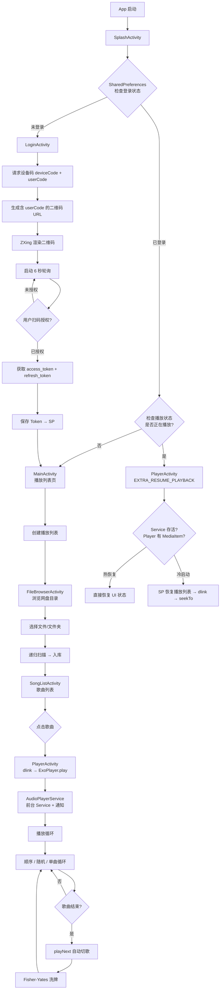

# 车载网盘音乐播放器 — Kotlin 迁移与重构需求文档

> 版本: 1.2  
> 日期: 2026-08-07  
> 目标平台: Android 10+ (minSdk 28, targetSdk 29)  
> 源语言: Java  (37 文件, ~5,857 行)  
> 目标语言: Kotlin  
> Java 业务参考项目: `pan-music-car-player` (`/Users/liuguanyu/devspace/pan-music-car-player`)  
> Kotlin 工程参考项目: `pan-car-player-kt` (`/Users/liuguanyu/devspace/pan-car-player-kt`)（已成功在车机运行，下文标注 🚗）

---

## 目录

1. [背景与动机](#1-背景与动机)
2. [核心原则](#2-核心原则)
3. [当前系统基线](#3-当前系统基线)
4. [业务流与用例场景](#4-业务流与用例场景)
5. [参考项目分析](#5-参考项目分析)
6. [蓝牙焦点与媒体按键：从打补丁到顶层重设计](#6-蓝牙焦点与媒体按键从打补丁到顶层重设计)
7. [Kotlin 迁移方案](#7-kotlin-迁移方案)
8. [架构重构方案](#8-架构重构方案)
9. [实时音频可视化模块](#9-实时音频可视化模块)
10. [迁移阶段与工时估算](#10-迁移阶段与工时估算)
11. [验收标准](#11-验收标准)
12. [风险与对策](#12-风险与对策)

---

## 1. 背景与动机

### 1.1 项目定位

车载网盘音乐播放器，运行于 Android 10+ 车机系统，核心功能为从百度网盘获取音频文件并播放。当前为 Java 实现，包含 37 个源文件、约 5,857 行代码。

### 1.2 迁移目标

| 目标 | 说明 |
|------|------|
| **语言现代化** | Java → Kotlin，利用空安全、协程、密封类等特性提升代码质量 |
| **架构规范化** | 从无分层架构演进为 MVVM + Repository 模式 |
| **功能增强** | 引入实时音频可视化（跳舞小羊等），基于 FFT 频率分析 |
| **可测试性** | 从零测试覆盖提升至 70%+ |
| **性能保障** | 保持或提升运行性能，消除主线程阻塞和内存泄漏隐患 |
| **车机兼容性** | 参考已验证的车机部署方案，确保 APK 可安装、可运行 |

### 1.3 参考项目

`pan-car-player-kt`（`/Users/liuguanyu/devspace/pan-car-player-kt`）是一个已在车机上成功运行的 Kotlin 网盘播放器，采用 Hilt + MVVM + Repository 架构，积累了丰富的车机部署经验。本需求文档基于对该项目的分析，多处直接采纳其工程实践。详见[第 5 章](#5-参考项目分析)。

---

## 2. 核心原则

以下原则贯穿整个迁移与重构过程，任何设计决策必须满足：

### 2.1 功能不丢失

```
迁移前后，所有用户可见功能必须保持一致：
✅ 百度网盘 OAuth 设备码登录
✅ 播放列表管理（创建/重命名/删除/刷新）
✅ 音频播放（顺序/随机/单曲循环）
✅ 文件浏览器（目录导航/文件选择/文件夹递归扫描）
✅ 歌词解析与显示（LRC 格式）
✅ 播放进度持久化（冷启动恢复）
✅ 后台播放（前台 Service + 通知栏控制）
✅ 音频焦点管理（蓝牙导航/来电的焦点抢占）
✅ 方向盘媒体按键（所有页面 + 后台均可响应）
```

### 2.2 职责单一

```
每个类只承担一个明确职责：

❌ 当前 AudioPlayerService：播放 + 焦点 + 通知 + 列表 + 随机 + 持久化 + 网络
✅ 重构后：
    AudioPlayerService   → 只负责前台 Service 生命周期 + 通知 + MediaSession
    AudioFocusManager    → 只负责音频焦点请求/释放/变化响应
    PlaybackController   → 只负责 ExoPlayer 播放控制（play/pause/seek/next）
    PlaylistController   → 只负责播放列表管理 + 随机算法
    PlaybackStateStore   → 只负责播放状态持久化
```

### 2.3 功能正交

```
不同功能模块之间通过接口通信，不直接依赖具体实现：

    Activity ← ViewModel ← Repository → DataSource (Room/Retrofit)
    
    可视化模块通过统一接口 AudioVisualizer 接入：
    VisualizerManager → AudioVisualizer (interface)
                         ├── BarsVisualizer
                         ├── WaveVisualizer
                         ├── ParticlesVisualizer
                         └── DancingSheepVisualizer
```

### 2.4 Kotlin 最佳实践

| 实践 | 用途 |
|------|------|
| `data class` | 替换所有 Model 层的 getter/setter 样板 |
| `sealed interface` | 🚗 播放状态机、UI 事件，编译期穷尽检查（比 `sealed class` 更灵活，可多实现） |
| `suspend` + 协程 | 替代所有 `Callback` 回调链和 `Handler.postDelayed` |
| `StateFlow` | 🚗 播放状态流转，替代 `PlaybackStateListener` 回调接口；每个设置项一个 Flow |
| `by lazy` / `lateinit` | 延迟初始化，避免 `!!` 非空断言 |
| 扩展函数 | `Canvas.withSave{}` / `Paint.apply{}` 消除模板 |
| Hilt DI | 替代手动单例；`@Named` / 自定义 `@Qualifier` 区分同类注入 |
| `fun interface` | 🚗 单方法接口抽象（如 `TransactionRunner`），测试时可注入零依赖版本 |
| `@VisibleForTesting` | 标注仅因测试而放宽可见性的方法 |

### 2.5 保证运行性能

```
性能约束：
1. 所有数据库操作 → 必须在后台线程（suspend + Dispatchers.IO）
2. 所有网络请求   → 必须在后台线程（Retrofit + 协程）
3. Canvas 动画    → 帧率可控（播放 60fps / 暂停 15fps），不可见时停止
4. Shader 对象    → 创建一次、复用，不允许每帧 new
5. RecyclerView   → 使用 ListAdapter + DiffUtil，禁止 notifyDataSetChanged 全量刷新
6. 内存           → 动画 View 脱离 Window 时必须停止渲染循环
```

### 2.6 可测试

```
测试覆盖目标：
1. ViewModel 层     → 单元测试覆盖 100%（MockK + Turbine + MainCoroutineRule）
2. Repository 层    → 单元测试覆盖 80%+（Fake 实现注入）
3. 音频分析算法     → 单元测试覆盖 100%
4. 随机播放算法     → 单元测试覆盖 100%
5. 音频焦点状态机   → 单元测试覆盖 100%
6. UI 层           → 关键路径集成测试（Espresso + HiltTesting）
```

### 2.7 车机兼容性约束

```
🚗 以下约束来自 pan-car-player-kt 在真实车机上的部署经验：
1. targetSdk=29  → 部分魔改车机 PackageParser 拒绝解析 targetSdk > 29 的 APK
2. V1+V2 双签名  → 部分 Android 10 车机（魔改 AOSP）仍走 v1 校验
3. JNI 传统打包  → useLegacyPackaging=true，.so 压缩存储、安装时解压，兼容旧车机安装器
4. ABI 拆分      → arm64-v8a + armeabi-v7a，生成小包（车机 U 盘安装时临时解析缓冲有限）
5. Release 签名  → 车机必须安装已签名 APK，未签名产物无法部署
```

---

## 3. 当前系统基线

### 3.1 文件清单

| 层 | 文件 | 行数 |
|----|------|:--:|
| Application | `CarPlayerApplication.java` | 64 |
| Activity | `SplashActivity.java` | 86 |
| | `LoginActivity.java` | 205 |
| | `MainActivity.java` | 459 |
| | `PlayerActivity.java` | 1,168 |
| | `SongListActivity.java` | 537 |
| | `FileBrowserActivity.java` | 432 |
| Service | `AudioPlayerService.java` | 1,318 |
| Adapter | `CurrentPlaylistAdapter.java` | 196 |
| | `FileAdapter.java` | 252 |
| | `PlaylistAdapter.java` | 149 |
| | `PlaylistGridAdapter.java` | 93 |
| | `SongAdapter.java` | 233 |
| Auth | `BaiduAuthService.java` | 436 |
| Database | `AppDatabase.java` | 15 |
| | `DatabaseManager.java` | 51 |
| | `PlaylistDao.java` | 35 |
| | `SongDao.java` | 54 |
| Manager | `LyricsManager.java` | 338 |
| | `PlaylistManager.java` | 521 |
| Model | `Song.java` | 239 |
| | `FileItem.java` | 122 |
| | `Playlist.java` | 63 |
| | `AuthInfo.java` | 107 |
| | `DownloadLinkResponse.java` | 112 |
| | `FileListResponse.java` | 35 |
| | `TokenResponse.java` | 104 |
| | `DeviceCodeResponse.java` | 103 |
| Network | `RetrofitClient.java` | 100 |
| | `BaiduPanService.java` | 89 |
| | `ApiConstants.java` | 31 |
| | `RetryInterceptor.java` | 63 |
| Utils | `LrcParser.java` | 127 |
| Widget | `LrcView.java` | 174 |
| | `RotatingDiscView.java` | 362 |
| | `RotatingTextView.java` | 176 |
| | `ParticleBackgroundView.java` | 160 |
| **合计** | **37 文件** | **~5,857** |

### 3.2 关键技术栈

| 组件 | 版本 | 用途 |
|------|------|------|
| Media3 ExoPlayer | 1.0.0 | 音频播放 |
| Room | 2.5.0 | 本地数据库 |
| Retrofit + OkHttp | 2.9.0 / 4.11.0 | 百度网盘 API |
| Glide | 4.15.1 | 图片加载 |
| Gson | 2.10.1 | JSON 解析 |
| ZXing | 3.5.1 / 4.3.0 | 二维码生成/扫描 |
| Material Components | 1.9.0 | UI 组件 |
| MultiDex | 2.0.1 | 方法数超限 |

### 3.3 已知工程问题

| 严重度 | 问题 | 位置 |
|:--:|------|------|
| 🔴 | 死代码 `previous()` / `next()` 与 `playPrevious()` / `playNext()` 并存 | `AudioPlayerService.java` |
| 🔴 | `play()` 无参无防御：ExoPlayer 无 MediaItem 时静默失败 | `AudioPlayerService.java` |
| 🔴 | 数据库同步调用阻塞主线程 | `DatabaseManager.java`, `PlaylistManager.java` |
| 🔴 | `ParticleBackgroundView.onDraw()` 无限重绘循环 | `ParticleBackgroundView.java` |
| 🟡 | Shimmer 流光每帧 `new LinearGradient` → GC 压力 | `PlayerActivity.java` |
| 🟡 | `AudioPlayerService` 上帝类，1,318 行 8 种职责混杂 | `AudioPlayerService.java` |
| 🟡 | `dispatchKeyEvent` 在 3 个 Activity 中逐字复制 | `PlayerActivity`, `MainActivity`, `SongListActivity` |
| 🟡 | 零测试覆盖 | 全局 |
| 🟢 | 没有 DI 框架，手动单例 | 全局 |
| 🟢 | Token 明文存储于 SharedPreferences | `BaiduAuthService.java` |

---

## 4. 业务流与用例场景

### 4.1 核心业务流



### 4.2 用例场景清单

以下用例按用户旅程的时间顺序排列，覆盖从首次登录到后台播放的完整生命周期：

#### UC-01 首次登录（设备码授权）

| 维度 | 内容 |
|------|------|
| **触发条件** | App 首次启动，SP 中无有效 Token |
| **涉及组件** | `LoginActivity`, `BaiduAuthService`, `RetrofitClient` |
| **核心流程** | 1. 调用百度 OAuth API 获取 `device_code` + `user_code` + `verification_url`<br>2. 拼接完整 URL `verification_url?code=userCode`<br>3. ZXing 生成 280×280 二维码显示<br>4. 启动 `Handler.postDelayed` 每 6 秒轮询 Token 端点<br>5. 用户扫码授权后，轮询获取 `access_token` + `refresh_token`<br>6. 停止轮询，Token 保存到 SharedPreferences<br>7. 跳转 `MainActivity` |
| **迁移要点** | 轮询 `Handler` → `CoroutineScope.launch` + `delay`；二维码生成逻辑不变；Token 存储改为 `EncryptedSharedPreferences` |

#### UC-02 已登录冷启动恢复

| 维度 | 内容 |
|------|------|
| **触发条件** | 进程被杀后重新打开，SP 中 Token 有效 |
| **涉及组件** | `SplashActivity`, `PlayerActivity`, `AudioPlayerService` |
| **核心流程** | 1. `SplashActivity.onCreate` → `Handler.postDelayed(1s)` → `checkLoginStatus()`<br>2. 检查 SP 中 `is_logged_in` + `is_playing` 标志<br>3. **热恢复路径**：Service 存活且 `isPlayerReady()`（MediaItemCount > 0）→ 直接跳 PlayerActivity 恢复 UI<br>4. **冷启动路径**：Service 存活但 Player 无 MediaItem → SP 恢复播放列表 JSON → dlink 获取播放地址 → seekTo 上次位置<br>5. 随机模式重新生成 Fisher-Yates 洗牌序列 |
| **迁移要点** | SP 反序列化播放列表 → Room 查询替代；冷/热恢复逻辑收敛到 `PlaybackRepository.restoreState()`；`Handler.postDelayed` → `delay` |

#### UC-03 创建播放列表 → 添加歌曲

| 维度 | 内容 |
|------|------|
| **触发条件** | 用户在 MainActivity 点击"新建播放列表" |
| **涉及组件** | `MainActivity`, `FileBrowserActivity`, `PlaylistManager`, `SongDao` |
| **核心流程** | 1. `showCreatePlaylistDialog()` → 输入名称 → `PlaylistManager.createPlaylist()`<br>2. 进入 `FileBrowserActivity` 浏览百度网盘目录<br>3. 选择文件/文件夹 → 文件夹触发 `scanFolder()` 递归扫描<br>4. `pendingScans` 计数器保护并发：每进入子目录 +1，异步回调完成后 -1<br>5. 所有 `pendingScans == 0` → `finishAddingFiles()` 批量调用 `SongDao.insertAll()`<br>6. 更新播放列表 → 跳转 `SongListActivity` |
| **迁移要点** | `pendingScans` 计数器 → 协程 `async { }.awaitAll()` 结构化并发；`SongDao` 同步 → `suspend fun`；PlaylistManager 回调 → Repository |

#### UC-04 播放列表 CRUD

| 维度 | 内容 |
|------|------|
| **触发条件** | 用户在 MainActivity 管理播放列表 |
| **涉及组件** | `MainActivity`, `PlaylistManager`, `PlaylistDao`, `PlaylistAdapter` |
| **核心流程** | 1. 刷新：`PlaylistManager.refreshPlaylist()` → 重新拉取网盘文件 → 更新歌曲列表<br>2. 重命名：弹出 Dialog → `PlaylistManager.updatePlaylist()`<br>3. 删除：确认 Dialog → `PlaylistManager.deletePlaylist()` + 级联删除歌曲<br>4. 多选删除：`AlertDialog` 多选列表 → 批量删除 |
| **迁移要点** | 所有 `PlaylistManager` 回调接口 → `suspend` Repository；`RecyclerView.Adapter` → `ListAdapter + DiffUtil` |

#### UC-05 从歌曲列表开始播放

| 维度 | 内容 |
|------|------|
| **触发条件** | 用户在 SongListActivity 点击某首歌曲 |
| **涉及组件** | `SongListActivity`, `PlayerActivity`, `AudioPlayerService` |
| **核心流程** | 1. 点击 → 传递播放列表 + 位置 → `PlayerActivity` (Intent Serializable)<br>2. `PlayerActivity.onCreate` → `audioPlayerService.setPlaylist()`<br>3. 调用百度网盘 API 获取 dlink 播放地址<br>4. `ExoPlayer.setMediaItem()` + `prepare()` + `play()`<br>5. 请求音频焦点 `requestAudioFocus()`<br>6. 更新前台通知 + MediaSession ，保存播放状态 |
| **迁移要点** | Intent Serializable → `PlaylistCache` @Singleton 内存传递；dlink 获取 → Repository；焦点请求 → `AudioFocusManager` |

#### UC-06 播放控制（播放/暂停/切歌/Seek/音量/模式）

| 维度 | 内容 |
|------|------|
| **触发条件** | 用户在 PlayerActivity 操作播放控件 |
| **涉及组件** | `PlayerActivity`, `AudioPlayerService` |
| **核心流程** | 1. 播放/暂停 → `audioPlayerService.play()` / `pause()`<br>2. 上一曲/下一曲 → `playPrevious()` / `playNext()`（非 dead code 的 `previous`/`next`）<br>3. Seek → `ExoPlayer.seekTo(position)`<br>4. 播放模式 → `setPlayMode(ORDER/RANDOM/SINGLE)`<br>5. 每次操作后 `savePlaybackState()` 持久化 |
| **迁移要点** | 分散的按钮回调 → ViewModel 统一状态管理；`savePlaybackState` 调用 → `PlaybackStateStore` 自动监听 StateFlow 变化 |

#### UC-07 自动切歌

| 维度 | 内容 |
|------|------|
| **触发条件** | 当前歌曲播放结束（`STATE_ENDED`） |
| **涉及组件** | `AudioPlayerService`, `ExoPlayer.Listener` |
| **核心流程** | 1. `ExoPlayer.Listener.onPlaybackStateChanged(STATE_ENDED)`<br>2. 调用 `playNext()` → 根据 `playMode` 分派：<br>   - **ORDER**：`currentPosition++`，到头循环<br>   - **RANDOM**：`shufflePosition++`，Fisher-Yates 洗牌重新生成，避免首尾衔接重复<br>   - **SINGLE**：当前位置不变，seekTo(0)<br>3. 选择下一首后调用 dlink API → `setMediaItem()` → `play()` → `savePlaybackState()` |
| **迁移要点** | `ExoPlayer.Listener` → `PlaybackController` 内部处理；Fisher-Yates 算法独立为 `ShuffleStrategy` fun interface，可单元测试 |

#### UC-08 后台播放（前台通知 + MediaSession）

| 维度 | 内容 |
|------|------|
| **触发条件** | 用户离开 PlayerActivity 或 App 进入后台 |
| **涉及组件** | `AudioPlayerService`（前台 Service） |
| **核心流程** | 1. `startForeground(NOTIFICATION_ID, notification)` → 显示歌曲名、控制按钮<br>2. `MediaSessionCompat` 绑定 → 锁屏/通知栏媒体控制<br>3. 通知栏按钮 → `PendingIntent` → `onStartCommand()` → `handleMediaAction()` → switch case<br>4. MediaSession 回调 → service 内部匿名类直接操作 ExoPlayer<br>5. 播放状态变化 → `updateMediaSessionState()` / `updateNotification()` |
| **迁移要点** | `handleMediaAction` switch → `MediaKeyDispatcher.emit(MediaCommand)`；MediaSession 回调 → 统一走 `MediaKeyDispatcher`；Service 大幅瘦身 |

#### UC-09 蓝牙导航语音抢占焦点（CAN_DUCK）

| 维度 | 内容 |
|------|------|
| **触发条件** | 蓝牙连接手机导航（如百度地图），导航语音播报 |
| **涉及组件** | `AudioPlayerService`, `AudioManager`, `AudioFocusRequest` |
| **当前行为** | 1. 系统回调 `AUDIOFOCUS_LOSS_TRANSIENT_CAN_DUCK`<br>2. `volumeBeforeDuck = currentVolume` 保存当前音量<br>3. `exoPlayer.setVolume(0.2f)` 降音至 20%（不暂停）<br>4. 导航结束 → `AUDIOFOCUS_GAIN` → `setVolume(volumeBeforeDuck)` 恢复音量 |
| **迁移要点** | 匿名 `OnAudioFocusChangeListener` → `AudioFocusManager` 的 `StateFlow<FocusCommand>`；`PlaybackController` 消费 `LostTransientCanDuck` → `player.setVolume(0.2f)` |

#### UC-10 蓝牙来电抢占焦点（LOSS_TRANSIENT）

| 维度 | 内容 |
|------|------|
| **触发条件** | 蓝牙连接手机，来电/拨出电话 |
| **涉及组件** | `AudioPlayerService`, `AudioManager` |
| **当前行为** | 1. 系统回调 `AUDIOFOCUS_LOSS_TRANSIENT`<br>2. `wasPlayingBeforeFocusLoss = true` 标记<br>3. `exoPlayer.pause()` 暂停播放<br>4. 通话结束 → `AUDIOFOCUS_GAIN` → `if (wasPlayingBeforeFocusLoss) exoPlayer.play()` 恢复播放 |
| **迁移要点** | 与 UC-09 统一由 `AudioFocusManager` 发射命令，`PlaybackController` 消费 |

#### UC-11 其他音乐 App 抢占焦点（LOSS）

| 维度 | 内容 |
|------|------|
| **触发条件** | 其他 App（如车机自带收音机）请求音频焦点 |
| **涉及组件** | `AudioPlayerService`, `AudioManager` |
| **当前行为** | 1. 系统回调 `AUDIOFOCUS_LOSS`<br>2. `wasPlayingBeforeFocusLoss = false`（不恢复）<br>3. `exoPlayer.pause()` → `updateNotification()` → `abandonAudioFocus()` 释放焦点 |
| **迁移要点** | 与 UC-09/UC-10 统一处理 |

#### UC-12 方向盘媒体按键

| 维度 | 内容 |
|------|------|
| **触发条件** | 用户按下方向盘上的媒体键（播放/暂停/上一曲/下一曲） |
| **涉及组件** | `PlayerActivity`, `MainActivity`, `SongListActivity`, `AudioPlayerService`（MediaSession 回调 + PendingIntent） |
| **当前行为** | 1. **Activity 层**：3 个 Activity 各自 `dispatchKeyEvent()` 中 switch keyCode（KEYCODE_MEDIA_PLAY_PAUSE / NEXT / PREVIOUS），逐字复制 ~30 行<br>2. **MediaSession 层**：`MediaSessionCompat.Callback.onPlay/onPause/onSkipToNext/onSkipToPrevious` → 直接调 Service 方法<br>3. **通知栏层**：`PendingIntent` → `handleMediaAction()` switch<br>→ 三个入口三条路径，新增 Activity 需手动添加 |
| **迁移要点** | 三个入口 → `MediaKeyDispatcher.dispatch()` 一行接入；`BaseCarActivity` 抽取公共逻辑；所有 Activity 共享一个 Hilt `@ActivityScoped` 实例 |

#### UC-13 显示音频格式信息

| 维度 | 内容 |
|------|------|
| **触发条件** | 歌曲开始播放或切换时 |
| **涉及组件** | `PlayerActivity`, `AudioPlayerService` |
| **当前行为** | 1. `ExoPlayer.Listener.onPlaybackStateChanged(READY)` → 获取 `AudioFormat`<br>2. 解析 `sampleRate` / `channelCount` / `sampleMimeType` / `bitrate`<br>3. 格式化显示：`FormatInfo(44.1kHz / 16bit / 320kbps / MP3)`<br>4. 通过 `PlaybackStateListener` 回调通知 PlayerActivity 更新 UI |
| **迁移要点** | `PlaybackStateListener` 回调 → `StateFlow<FormatInfo>`；FormatInfo data class 替换 String 拼接 |

#### UC-14 播放进度持久化

| 维度 | 内容 |
|------|------|
| **触发条件** | 播放状态变化时（播放/暂停/切歌/Seek/模式切换） |
| **涉及组件** | `AudioPlayerService`, `SharedPreferences` |
| **当前行为** | 1. 每次关键操作后调用 `savePlaybackState()`<br>2. 将 `currentPosition`、`position(ms)`、`playMode`、`shufflePosition`、`currentPlaylistId` 等序列化为 JSON → SP<br>3. 播放列表以 Song 列表 JSON 全部存储（含 dlink 等冗余信息）<br>4. 冷启动恢复时从 SP 反序列化 → 重建播放状态 |
| **迁移要点** | 播放列表不用 SP 存储（增大无意义）→ Room 查询 `songsByPlaylistId`；SP 只存 `playlistId + position + progress + playMode` 等元数据；`PlaybackStateStore` 独立类，监听 StateFlow 自动保存 |

### 4.3 用例汇总

| 编号 | 场景 | 核心组件 | 迁移关键点 |
|:--:|------|------|------|
| UC-01 | 首次登录 | LoginActivity, BaiduAuthService | Handler 轮询 → 协程；Token 加密存储 |
| UC-02 | 冷启动恢复 | SplashActivity, PlayerActivity | SP 反序列化 → Room；热/冷路径收敛 |
| UC-03 | 创建列表 → 添加歌曲 | MainActivity, FileBrowserActivity | `pendingScans` → `awaitAll`；DAO suspend |
| UC-04 | 播放列表 CRUD | MainActivity, PlaylistManager | 回调 → Repository；ListAdapter |
| UC-05 | 开始播放 | SongListActivity, PlayerActivity | Intent Serializable → PlaylistCache |
| UC-06 | 播放控制 | PlayerActivity, AudioPlayerService | ViewModel + StateFlow 状态管理 |
| UC-07 | 自动切歌 | AudioPlayerService | ShuffleStrategy 独立可测 |
| UC-08 | 后台播放 | AudioPlayerService (Foreground) | Service 瘦身 + MediaKeyDispatcher |
| UC-09 | 蓝牙导航焦点 | AudioManager | AudioFocusManager + StateFlow |
| UC-10 | 蓝牙来电焦点 | AudioManager | 同上，统一命令总线 |
| UC-11 | 其他 App 抢占 | AudioManager | 同上 |
| UC-12 | 方向盘按键 | 3 个 Activity + Service | MediaKeyDispatcher 一行接入 |
| UC-13 | 音频信息显示 | PlayerActivity | StateFlow<FormatInfo> 替代回调 |
| UC-14 | 进度持久化 | SharedPreferences | PlaybackStateStore + Room 查询 |

---

## 5. 参考项目分析

`pan-car-player-kt` 是一个已在真实车机上成功部署运行的 Kotlin 网盘播放器。以下为可借鉴的关键工程实践：

### 5.1 规模对比

| 维度 | Java 版（当前） | Kotlin 版（参考） |
|------|:--:|:--:|
| 源文件 | 37 个 Java | ~82 个 Kotlin |
| 测试文件 | 0 | 32 个（unit + instrumented） |
| Hilt DI Module | 0（手动单例） | 8 个 |
| ViewModel | 0 | 6 个 |
| Repository | 0 | 4 个 |
| 架构模式 | 上帝类 Service | MVVM + Repository + Strategy |
| 车机兼容配置 | 无 | V1+V2 签名、targetSdk=29、JNI legacy packaging、ABI splits |

### 5.2 技术选型差异

| 维度 | Java 版（当前） | Kotlin 版（参考） | 迁移决策 |
|------|------|------|------|
| 构建脚本 | Groovy `build.gradle` | Kotlin DSL `build.gradle.kts` | **采用** |
| 依赖管理 | 硬编码版本号 | Version Catalog (`libs.versions.toml`) | **采用** |
| 密钥管理 | `BaiduConfig.java` 硬编码占位符 | `local.properties` → `BuildConfig` 注入 | **采用** |
| Token 存储 | 明文 `SharedPreferences` | `EncryptedSharedPreferences` (AES-256 GCM) | **采用** |
| 旧数据迁移 | 无 | `AuthMigration` 一次性明文→加密迁移 | **采用** |
| 测试 Mock | 无 | MockK + Turbine | **采用** |
| 协程测试 | 无 | `MainCoroutineRule` + `UnconfinedTestDispatcher` | **采用** |
| 数据库事务 | 无事务保护 | `TransactionRunner` fun interface | **采用** |
| Activity 间数据传递 | Intent Serializable | `PlaylistCache` @Singleton 内存共享 | **采用** |
| 设置持久化 | 分散的 SharedPreferences | `SettingsRepository` + per-setting `StateFlow` | **采用** |
| UI 事件 | `PlaybackStateListener` 回调接口 | `sealed interface` + `SharedFlow` | **采用** |
| 混淆 | 无 | R8 full mode + 资源压缩 | **采用** |
| 覆盖率 | 无 | JaCoCo (`enableJacoco` 按需开启) | **采用** |
| Retrofit Qualifier | 单一 Retrofit | `@PanApi` / `@OAuthApi` 双 Retrofit（不同 BaseUrl） | **采用** |

### 5.3 Hilt Module 结构参考

```
di/
├── AuthModule.kt        → @AuthPrefs Qualifier + EncryptedSharedPreferences（Keystore 失败降级明文）
├── DatabaseModule.kt    → Room + TransactionRunner
├── NetworkModule.kt     → @PanApi / @OAuthApi 双 Retrofit
├── PlayerModule.kt      → VideoPlayerEngine 策略绑定
├── SettingsModule.kt    → @Named("settings_prefs") SharedPreferences
└── Qualifiers.kt        → @PanApi / @OAuthApi / @AuthPrefs 自定义 Qualifier
```

### 5.4 不需要借鉴的（与我们需求不同）

| 功能 | 原因 |
|------|------|
| `VideoPlayerEngine` + LibVLC 双引擎 | 我们是纯音频播放器 |
| `GeocodingStrategy` / `LocationExtractor` | 不需要地理位置提取 |
| `ImageEffectStrategy` / `BlindsImageView` | 图片特效不在需求范围内 |

---

## 6. 蓝牙焦点与媒体按键：从打补丁到顶层重设计

当前代码中这两个问题已通过补丁修复（手动 `AudioFocusRequest` + `dispatchKeyEvent` 逐 Activity 复制）。但补丁架构存在根本缺陷：**行为逻辑与系统回调紧耦合，无法独立测试，多入口代码重复**。

Kotlin 迁移时应对这两个系统级关注点做**顶层重设计**，遵循 **"多源发射命令，单点执行命令"** 的命令总线模式。

### 6.1 当前架构缺陷

```
蓝牙焦点（补丁架构）:
  Android 系统 → OnAudioFocusChangeListener (匿名回调)
    → AudioPlayerService 内部 if/switch
      → 直接操作 ExoPlayer (play/pause/setVolume)

  缺陷:
  ✗ 回调嵌在 Service 内部，无法单元测试
  ✗ 焦点状态散落在 boolean + float 字段中
  ✗ 其他组件（ViewModel）无法感知焦点变化

方向盘按键（补丁架构）:
  输入源:
    Activity.dispatchKeyEvent()  → audioPlayerService.play/pause  (3个Activity逐字复制)
    MediaSession.Callback         → audioPlayerService.play/pause  (Service内部)
    通知栏按钮 PendingIntent      → onStartCommand() switch        (Service内部)

  缺陷:
  ✗ 三个入口各有一条调用路径，行为可能不一致
  ✗ dispatchKeyEvent 在 3 个 Activity 中逐字复制 30 行
  ✗ 新增 Activity 必须记住添加，漏掉就失效
```

### 6.2 目标架构：命令总线模式

所有输入通道统一发射 `MediaCommand` / `FocusCommand`，由 `PlaybackController` 单点消费：

```
                      ┌─────────────────────────────────┐
                      │       PlaybackController         │
                      │       (单点命令执行器)            │
                      │                                  │
                      │  collect(mediaCommands)  ←──┐    │
                      │  collect(focusCommands) ←──┐│    │
                      │         ↓                  ││    │
                      │  ExoPlayer.play/pause/...  ││    │
                      └─────────────────────────────┘│    │
                  MediaCommand (SharedFlow)          │    │
                 ┌────────────────────┘              │    │
                 │                                    │    │
    ┌────────────┴────────────┐          ┌────────────┴──────────┐
    │   MediaKeyDispatcher    │          │   AudioFocusManager   │
    │   (多源 → 统一发射)     │          │   (系统API → Flow)    │
    │                         │          │                       │
    │ ← Activity按键          │          │ ← AudioFocusRequest   │
    │ ← MediaSession.Callback │          │ ← FocusChangeListener │
    │ ← 通知栏 PendingIntent  │          │                       │
    └─────────────────────────┘          └───────────────────────┘
```

### 6.3 关键类型定义

```kotlin
sealed interface MediaCommand {
    data object Play : MediaCommand
    data object Pause : MediaCommand
    data object TogglePlayPause : MediaCommand
    data object Next : MediaCommand
    data object Previous : MediaCommand
}

sealed interface FocusCommand {
    data object Gained : FocusCommand
    data object LostPermanent : FocusCommand
    data object LostTransient : FocusCommand
    data object LostTransientCanDuck : FocusCommand
}
```

### 6.4 MediaKeyDispatcher：一行接入，消除重复

所有 Activity 共享同一个 Hilt `@ActivityScoped` 实例，每个 Activity 只需一行接入：

```kotlin
@ActivityScoped
class MediaKeyDispatcher @Inject constructor() {
    private val _commands = MutableSharedFlow<MediaCommand>(extraBufferCapacity = 4)
    val commands: SharedFlow<MediaCommand> = _commands.asSharedFlow()

    fun dispatch(event: KeyEvent): Boolean {
        if (event.action != KeyEvent.ACTION_DOWN) return false
        val command = when (event.keyCode) {
            KeyEvent.KEYCODE_MEDIA_PLAY_PAUSE -> MediaCommand.TogglePlayPause
            KeyEvent.KEYCODE_MEDIA_PLAY -> MediaCommand.Play
            KeyEvent.KEYCODE_MEDIA_PAUSE -> MediaCommand.Pause
            KeyEvent.KEYCODE_MEDIA_NEXT -> MediaCommand.Next
            KeyEvent.KEYCODE_MEDIA_PREVIOUS -> MediaCommand.Previous
            else -> return false
        }
        _commands.tryEmit(command)
        return true
    }

    fun emit(command: MediaCommand) { _commands.tryEmit(command) }
}

// 每个 Activity 接入方式（一行）：
// override fun dispatchKeyEvent(e: KeyEvent) = mediaKeyDispatcher.dispatch(e) || super.dispatchKeyEvent(e)
```

### 6.5 AudioFocusManager：从匿名回调到 StateFlow

将 `AudioManager` 系统回调转换为 `StateFlow`，脱离 Service 生命周期，可独立单元测试：

```kotlin
@Singleton
class AudioFocusManager @Inject constructor(
    @ApplicationContext private val context: Context
) {
    private val audioManager = context.getSystemService(Context.AUDIO_SERVICE) as AudioManager
    private val _focusCommands = MutableStateFlow<FocusCommand>(FocusCommand.Gained)
    val focusCommands: StateFlow<FocusCommand> = _focusCommands.asStateFlow()
    private var focusRequest: AudioFocusRequest? = null

    private val listener = AudioManager.OnAudioFocusChangeListener { change ->
        _focusCommands.value = when (change) {
            AudioManager.AUDIOFOCUS_GAIN -> FocusCommand.Gained
            AudioManager.AUDIOFOCUS_LOSS -> FocusCommand.LostPermanent
            AudioManager.AUDIOFOCUS_LOSS_TRANSIENT -> FocusCommand.LostTransient
            AudioManager.AUDIOFOCUS_LOSS_TRANSIENT_CAN_DUCK -> FocusCommand.LostTransientCanDuck
            else -> FocusCommand.Gained
        }
    }

    fun request(): Boolean { /* 创建 AudioFocusRequest 并请求 */ }
    fun abandon() { focusRequest?.let { audioManager.abandonAudioFocusRequest(it) } }
}
```

### 6.6 PlaybackController：单点消费两个 Flow

焦点变化和用户按键全部收敛到一处，状态机逻辑集中、可测试：

```kotlin
@Singleton
class PlaybackController @Inject constructor(
    private val exoPlayer: Provider<ExoPlayer>,
    private val focusManager: AudioFocusManager,
    private val mediaKeyDispatcher: MediaKeyDispatcher,
    @ApplicationScope private val scope: CoroutineScope
) {
    init {
        scope.launch {  // 消费用户命令
            mediaKeyDispatcher.commands.collect { cmd ->
                when (cmd) {
                    MediaCommand.Play -> ...
                    MediaCommand.Pause -> ...
                    // ...
                }
            }
        }
        scope.launch {  // 消费焦点命令
            focusManager.focusCommands.collect { cmd ->
                when (cmd) {
                    FocusCommand.Gained -> /* 恢复音量 + 恢复播放 */
                    FocusCommand.LostTransient -> /* 暂停 */
                    FocusCommand.LostTransientCanDuck -> /* 降音至20% */
                    FocusCommand.LostPermanent -> /* 停止并释放焦点 */
                }
            }
        }
    }
}
```

### 6.7 服务端瘦身

重设计后，`AudioPlayerService` 不再包含焦点或按键逻辑，只负责前台 Service 生命周期 + 通知 + MediaSession：

```kotlin
@AndroidEntryPoint
class AudioPlayerService : Service() {
    @Inject lateinit var mediaKeyDispatcher: MediaKeyDispatcher

    // MediaSession 回调 → 直接走统一发射器
    private val callback = object : MediaSessionCompat.Callback() {
        override fun onPlay() = mediaKeyDispatcher.emit(MediaCommand.Play)
        override fun onPause() = mediaKeyDispatcher.emit(MediaCommand.Pause)
        override fun onSkipToNext() = mediaKeyDispatcher.emit(MediaCommand.Next)
        override fun onSkipToPrevious() = mediaKeyDispatcher.emit(MediaCommand.Previous)
    }
    
    // Service 中不再有：OnAudioFocusChangeListener、handleMediaAction、wasPlayingBeforeFocusLoss、volumeBeforeDuck
}
```

### 6.8 可测试性对比

| 测试场景 | 补丁架构 | 重设计后 |
|---------|---------|---------|
| 焦点丢失 → 暂停 | 需启动 Service + ExoPlayer + Mock AudioManager | 注入 `MutableStateFlow(LostTransient)`，验证 `player.pause()` 调用 |
| 按键 Next → 下一首 | 需启动 Activity + 发送 KeyEvent | 调用 `mediaKeyDispatcher.emit(Next)`，验证控制器执行 |
| 焦点 Duck → 音量降 | 需真机 AudioManager | `focusCommands.value = LostTransientCanDuck`，验证 `volume = 0.2f` |

---

## 7. Kotlin 迁移方案

### 7.1 语言特性收益矩阵

| Kotlin 特性 | 当前痛点 | 迁移效果 |
|------------|---------|---------|
| `data class` | 8 个 Model 类共 ~900 行 getter/setter/toString 样板 | → ~80 行 |
| `sealed interface` | 🚗 播放状态用分散的 `int` + `boolean` 表达；UI 事件无类型约束 | 编译期穷尽检查，Activity 必须处理所有事件分支 |
| `suspend` + 协程 | `Callback` 嵌套地狱；`Handler.postDelayed` 内存泄漏风险 | 线性代码 + 结构化并发 |
| `StateFlow` | 🚗 `PlaybackStateListener` 回调链；设置变化无法自动响应 UI | push 模式自动响应；每个设置项一个 Flow |
| `lateinit` / `by lazy` | `findViewById` 非空断言 | 零 NPE |
| 扩展函数 | `canvas.save()/restore()` 不配对风险 | `canvas.withSave{}` 自动 try-finally |
| Hilt DI | 🚗 手动双重检查锁单例，测试无法替换 | `@Inject` + Fake 注入；`@Named`/`@Qualifier` 区分同类实例 |
| `fun interface` | 🚗 单方法回调接口需匿名类 | `TransactionRunner` 一行实例化，测试注入零依赖版本 |
| `inline value class` | 基本类型误传 | `@JvmInline value class FsId(val id: Long)` 杜绝混淆 |

### 7.2 不需要迁移的组件

以下组件因性能或功能原因，**保留当前实现或直接删除**：

| 组件 | 决策 | 理由 |
|------|------|------|
| ExoPlayer 核心 | **保留** | Media3 自身就是 Kotlin/Java 混编，不需要改 |
| OkHttp / Retrofit | **保留** | 成熟三方库 |
| Room | **保留** | 原生支持 Kotlin suspend |
| ZXing / Glide | **保留** | 成熟三方库 |
| `previous()` / `next()` | **删除** | 死代码 |
| `RotatingDiscView` | **可选择保留或删除** | 迁移后若引入实时可视化，可作为 fallback 非 FFT 模式 |

### 7.3 新增依赖（Kotlin 生态）

| 依赖 | 版本 | 用途 |
|------|------|------|
| 🚗 MockK | 1.13.x | Kotlin-first mock（支持 suspend/object/inline） |
| 🚗 Turbine | 1.x | Flow 测试断言（`testFlow { awaitItem() }`） |
| 🚗 kotlinx.coroutines.test | 1.x | `UnconfinedTestDispatcher` + `TestScope` |
| 🚗 androidx.security.crypto | 1.1.0 | `EncryptedSharedPreferences` Token 加密存储 |
| 🚗 Hilt | 2.50+ | 依赖注入框架 + `@HiltAndroidApp` |
| 🚗 KSP | 匹配 Kotlin 版本 | Room/Hilt/Glide 注解处理器（替代 kapt） |

---

## 8. 架构重构方案

### 8.1 目标架构

```
┌─────────────────────────────────────────────────────┐
│  Activity / Fragment                                 │
│    ├── collect(ViewModel.state)    → 渲染 UI         │
│    ├── collect(ViewModel.events)  → 一次性事件        │
│    └── dispatchKeyEvent → MediaKeyDispatcher        │
│    ↓ observe                                         │
│  ViewModel (Jetpack)                                 │
│    ├── PlayerViewModel        (播放状态)             │
│    ├── PlaylistViewModel      (列表管理)             │
│    ├── FileBrowserViewModel   (文件浏览)             │
│    └── AuthViewModel          (登录状态)             │
│    ↓ call                                           │
│  Repository                                          │
│    ├── PlaybackRepository     (ExoPlayer 控制)       │
│    ├── PlaylistRepository     (Room DAO)             │
│    ├── FileRepository         (百度网盘 API)         │
│    ├── AuthRepository         (OAuth 流程)           │
│    └── SettingsRepository     (🚗 设置持久化)        │
│    ↓                                                │
│  DataSource                                          │
│    ├── Room DAO (suspend)                            │
│    ├── Retrofit ApiService                           │
│    ├── EncryptedSharedPreferences  (Token)           │
│    └── SharedPreferences           (播放偏好)        │
│                                                      │
│  跨 Activity 传递（🚗 PlaylistCache @Singleton）      │
│                                                      │
│  Foreground Service (独立)                           │
│    ├── AudioPlayerService    (通知 + MediaSession)   │
│    ├── AudioFocusManager     (焦点管理)              │
│    ├── MediaKeyDispatcher    (🚗 按键统一发射)       │
│    └── PlaybackController    (播放指令单点消费)       │
│                                                      │
│  Visualization (独立模块)                            │
│    ├── VisualizerManager     (FFT 管道调度)          │
│    ├── BarsVisualizer        (频谱柱)               │
│    ├── WaveVisualizer        (波形)                 │
│    ├── ParticlesVisualizer   (音频粒子)             │
│    └── DancingSheepVisualizer (跳舞小羊)            │
└─────────────────────────────────────────────────────┘
```

### 8.2 模块依赖规则

```
✅ 允许的依赖方向：
    ViewModel → Repository → DataSource
    Activity  → ViewModel
    VisualizerManager → AudioVisualizer (interface)

❌ 禁止的依赖方向：
    Repository → ViewModel
    DataSource → Repository
    ViewModel → View / Context
    Visualizer → Activity
    任何模块 → AudioPlayerService 的内部实现细节
```

### 8.3 Hilt Module 拆分

| Module | 职责 | 关键绑定 |
|--------|------|---------|
| `DatabaseModule` | Room DB + DAO + `TransactionRunner` | `@Singleton` AppDatabase, 各 DAO, `TransactionRunner` |
| `NetworkModule` | OkHttp + 双 Retrofit | `@PanApi` / `@OAuthApi` Retrofit, BaiduPanService |
| `AuthModule` | EncryptedSharedPreferences Token | `@AuthPrefs` SharedPreferences（Keystore 失败降级明文） |
| `SettingsModule` | 明文 SharedPreferences 偏好 | `@Named("settings_prefs")` SharedPreferences |
| `PlayerModule` | ExoPlayer + 焦点 + 按键 | ExoPlayer `@Singleton`, `AudioFocusManager`, `MediaKeyDispatcher` |
| `Qualifiers` | 自定义 Qualifier 注解 | `@PanApi`, `@OAuthApi`, `@AuthPrefs` |

### 8.4 关键接口定义

```kotlin
// 播放控制接口（ViewModel 层暴露给 UI）
interface PlaybackController {
    val state: StateFlow<PlaybackState>
    val currentSong: StateFlow<Song?>
    val progress: StateFlow<Long>
    
    fun play()
    fun pause()
    fun togglePlayPause()
    fun playNext()
    fun playPrevious()
    fun seekTo(position: Long)
    fun setPlayMode(mode: PlayMode)
}

// 🚗 数据库事务执行器（测试注入零依赖版本）
fun interface TransactionRunner {
    suspend fun runInTransaction(block: suspend () -> Unit)
}

// 音频焦点管理接口
interface AudioFocusManager {
    fun request(): Boolean
    fun abandon()
    val focusChanges: Flow<FocusChange>
}

// 可视化接口
interface AudioVisualizer {
    fun update(fft: ByteArray, width: Int, height: Int)
    fun draw(canvas: Canvas)
    fun reset()
    val name: String
}
```

### 8.5 密封类建模

```kotlin
// 播放状态机
sealed interface PlaybackState {
    data object Idle : PlaybackState
    data object Buffering : PlaybackState
    data class Playing(val position: Long, val duration: Long) : PlaybackState
    data class Paused(val position: Long, val duration: Long) : PlaybackState
    data class Error(val exception: Throwable) : PlaybackState
}

// 音频焦点变化
sealed interface FocusChange {
    data object Gained : FocusChange
    data object LostPermanent : FocusChange
    data object LostTransient : FocusChange
    data object LostTransientCanDuck : FocusChange
}

// 🚗 播放页一次性事件（ViewModel → Activity）
sealed interface PlaybackUiEvent {
    data class PlayAudio(val url: String) : PlaybackUiEvent
    data class ShowError(val message: String) : PlaybackUiEvent
    data object Finish : PlaybackUiEvent
}

// 播放模式
enum class PlayMode { ORDER, RANDOM, SINGLE }
```

### 8.6 安全模式

#### Token 加密存储

```kotlin
// AuthModule.kt → EncryptedSharedPreferences, 失败时降级明文
@AuthPrefs
fun provideAuthEncryptedSharedPreferences(@ApplicationContext context: Context): SharedPreferences =
    try {
        val masterKey = MasterKey.Builder(context).setKeyScheme(MasterKey.KeyScheme.AES256_GCM).build()
        EncryptedSharedPreferences.create(context, "baidu_auth", masterKey, ...)
    } catch (e: Exception) {
        Log.e(TAG, "EncryptedSharedPreferences 失败，降级明文", e)
        context.getSharedPreferences("baidu_auth_plain_fallback", Context.MODE_PRIVATE)
    }
```

#### 升级迁移

```kotlin
// BaiduCarApplication.onCreate() → 后台协程执行一次性明文 → 加密迁移
appScope.launch { authMigration.migrate() }
// migrate(): 检测旧明文 token → 写入加密存储 → 删除旧文件
```

#### PlaylistCache 跨 Activity 传递

```kotlin
@Singleton
class PlaylistCache @Inject constructor() {
    private val cache = ConcurrentHashMap<String, List<Song>>()
    fun put(id: String, songs: List<Song>) { cache[id] = songs }
    fun getAndRemove(id: String): List<Song>? = cache.remove(id)
}
// 避免 Intent Serializable 序列化大数据（车机性能敏感）
```

#### SettingsRepository 设置持久化

```kotlin
@Singleton
class SettingsRepository @Inject constructor(
    @Named(PREFS_QUALIFIER) private val prefs: SharedPreferences,
) {
    private val _playMode = MutableStateFlow(readPlayMode())
    val playMode: StateFlow<PlayMode> = _playMode.asStateFlow()
    
    fun setPlayMode(mode: PlayMode) {
        prefs.edit { putInt(KEY_PLAY_MODE, mode.value) }
        _playMode.value = mode
    }
    // 每个设置项一个 StateFlow，ViewModel 自动 collect 响应变化
}
```

---

## 9. 实时音频可视化模块

### 9.1 技术方案

```
FFT 数据流：
    ExoPlayer audioSessionId
        ↓
    android.media.audiofx.Visualizer (系统 API, API 9+)
        ↓ onFftDataCapture(ByteArray)
    AudioAnalyzer (低频/高频/节拍/强度分析)
        ↓
    VisualizerManager (帧率对齐, 分发)
        ↓
    AudioVisualizer interface
        ├── BarsVisualizer         (频谱柱状图)
        ├── WaveVisualizer         (波形图)
        ├── ParticlesVisualizer    (节拍粒子 + 律动圆)
        └── DancingSheepVisualizer (跳舞小羊)
        ↓ draw(Canvas)
    VisualizerView.onDraw()
```

### 9.2 FFT 管道实现

```kotlin
class AudioVisualizerPipeline(audioSessionId: Int) {
    
    private val analyzer = AudioAnalyzer()
    private val visualizers = mutableListOf<AudioVisualizer>()
    private var activeVisualizer: AudioVisualizer? = null
    
    private val visualizer = Visualizer(audioSessionId).apply {
        setCaptureSize(Visualizer.getCaptureSizeRange()[1])
        setDataCaptureListener(object : Visualizer.OnDataCaptureListener {
            override fun onFftDataCapture(v: Visualizer, fft: ByteArray, rate: Int) {
                val analysis = analyzer.analyze(fft)
                activeVisualizer?.update(fft, width, height)
            }
            override fun onWaveFormDataCapture(waveform: ByteArray?, samplingRate: Int) {}
        }, Visualizer.getMaxCaptureRate(), isWaveForm = false, isFft = true)
        enabled = true
    }

    fun switchTo(name: String) { activeVisualizer = visualizers.first { it.name == name } }
    fun draw(canvas: Canvas) { activeVisualizer?.draw(canvas) }
    fun release() { visualizer.release() }
}
```

### 9.3 可视化清单与规格

| 可视化 | 源码参考 | TS 行数 | Kotlin 预估 | 视觉效果 |
|--------|---------|:--:|:--:|------|
| **bars** | `BarsVisualizer.ts` | 21 | ~15 | FFT 频谱柱状图，渐变配色（绿→青→蓝） |
| **wave** | `WaveVisualizer.ts` | 24 | ~20 | FFT 波形曲线，青色描边 |
| **particles** | `ParticlesVisualizer.ts` | 105 | ~80 | 低频 > 阈值时从中心爆射粒子，中心圆随低频脉动 |
| **sheep** | `DancingSheepVisualizer.ts` | 444 | ~350 | 跳舞小羊：低音跳、高音摇头、音量呼吸缩放、随机吐舌 |

### 9.4 跳舞小羊 V1 详细规格

```
场景元素：
  - 纯蓝天空 (COLORS.SKY)
  - 纯绿草地 (COLORS.GRASS)
  - 白色栅栏 (COLORS.FENCE)
  - 三朵可移动云
  - 三只背景小羊（等比例缩小 0.3-0.4x，同频跳动）

主角小羊：
  - 白色羊毛身体（椭圆 + 蓬松弧轮廓）
  - 黑色圆形头部
  - 白色眼睛 + 黑色瞳孔
  - 四条黑色腿（随跳动弯曲）
  - 粉色舌头（节拍触发随机吐出）

音频响应映射：
  | 音频特征       | 小羊行为                  | 参数范围      |
  |---------------|--------------------------|--------------|
  | 低频 bass     | 垂直跳跃高度              | 0 ~ 40px     |
  | 高频 treble   | 头部摇头角度              | -30° ~ +30°  |
  | 音量 volume   | 身体缩放 (squash/stretch) | 0.7 ~ 1.3    |
  | 节拍 peak     | 吐舌头 + 表情切换         | 离散触发     |
  | 聚光灯        | 亮度 = 0.2 + volume * 0.6 | 0.2 ~ 0.8    |

帧率控制：
  - 播放时：与 Choreographer VSync 对齐（~60fps）
  - 暂停/不可见时：停止渲染循环
```

### 9.5 新增权限

```xml
<!-- Visualizer API 需要，normal 级别不弹窗 -->
<uses-permission android:name="android.permission.MODIFY_AUDIO_SETTINGS" />
```

---

## 10. 迁移阶段与工时估算

### 10.1 阶段划分

```
Phase 1  ████████░░░░░░░░░░░░  Build 配置 + Model 层         (2天)
Phase 2  ████████████████░░░░  数据层 + 协程化                 (3天)
Phase 3  ████████████████████  架构重构 ViewModel/Repository   (5天)
Phase 4  ████████████████████  Service 拆分 + 音频焦点         (4天)
Phase 5  ████████████████████  UI 层迁移 Activity/Adapter      (5天)
Phase 6  ████████████░░░░░░░░  音频可视化模块                   (6天)
Phase 7  ██████████░░░░░░░░░░  测试补全                         (3天)
```

### 10.2 详细工时分项

#### Phase 1 — Build 配置 + Model 层 (2天) 🚗

| 任务 | 工时 |
|------|:--:|
| 🚗 `build.gradle.kts` Kotlin DSL + Version Catalog (`libs.versions.toml`) | 0.3d |
| 🚗 车机兼容配置：`targetSdk=29`, `enableV1Signing=true`, `useLegacyPackaging=true`, ABI splits | 0.3d |
| 🚗 `local.properties` → `BuildConfig` 密钥注入（替代 `BaiduConfig.java` 硬编码） | 0.2d |
| 验证 Java/Kotlin 混编编译 | 0.2d |
| 8 个 Model 类 → Kotlin `data class`，保留 `@SerializedName`，验证 Gson 序列化兼容 | 0.5d |
| `ApiConstants` → `const val` | 0.1d |
| R8 full mode + 资源压缩 + ProGuard 规则补齐 | 0.2d |
| 验证编译产物一致性，确认无功能回退 | 0.2d |
| **小计** | **2d** |

#### Phase 2 — 数据层 + 协程化 (3天) 🚗

| 任务 | 工时 |
|------|:--:|
| Room DAO → `suspend fun`，移除同步调用 | 0.5d |
| 🚗 实现 `TransactionRunner` fun interface + Hilt 绑定（测试可注入同步版本） | 0.2d |
| 🚗 `RetrofitClient` → Hilt `@Module`（`@PanApi`/`@OAuthApi` 双 Retrofit Qualifier） | 0.5d |
| `BaiduPanService` → 挂起函数 | 0.3d |
| 🚗 `EncryptedSharedPreferences` 替代明文 Token 存储 + 降级逻辑 | 0.3d |
| `DatabaseManager` / `PlaylistManager` → suspend 重构 | 0.7d |
| 🚗 `AuthMigration` 一次性明文→加密 Token 迁移 | 0.3d |
| 验证数据库操作不再阻塞主线程 | 0.2d |
| **小计** | **3d** |

#### Phase 3 — 架构重构 (5天) 🚗

| 任务 | 工时 |
|------|:--:|
| 🚗 引入 Hilt：6 个 `@Module`（Database/Auth/Network/Settings/Player/Qualifiers） | 1d |
| 实现 `PlaybackRepository`、`PlaylistRepository`、`AuthRepository` | 1.5d |
| 🚗 实现 `SettingsRepository`（每设置项一个 `StateFlow`，ViewModel 自动 collect） | 0.5d |
| 实现 `PlayerViewModel`、`PlaylistViewModel` | 1d |
| 实现 `AudioFocusManager`（从 Service 中拆分，`StateFlow<FocusCommand>`） | 0.5d |
| 🚗 实现 `PlaylistCache` @Singleton（跨 Activity 传递数据，避免 Intent 序列化） | 0.2d |
| 编写 ViewModel 层单元测试 | 0.3d |
| **小计** | **5d** |

#### Phase 4 — Service 拆分 + 命令总线 (4天) 🚗

| 任务 | 工时 |
|------|:--:|
| `AudioPlayerService` 拆分：保留前台 Service + 通知 + MediaSession | 1d |
| 🚗 实现 `MediaKeyDispatcher`（`SharedFlow<MediaCommand>`，Activity 一行接入） | 0.5d |
| 迁移音频焦点逻辑到 `AudioFocusManager`（保留修复逻辑） | 0.5d |
| 迁移 MediaStyle 通知 + MediaSession + 方向盘按键处理 | 0.5d |
| 删除死代码 `previous()` / `next()` | 0.1d |
| `PlaybackController` 实现 + 与 ViewModel 对接（单点消费两个 Flow） | 0.7d |
| 音频焦点状态机单元测试 | 0.2d |
| **小计** | **3.5d** |

#### Phase 5 — UI 层迁移 (5天) 🚗

| 任务 | 工时 |
|------|:--:|
| `CarPlayerApplication` → `@HiltAndroidApp` + `AuthMigration` 后台启动 | 0.3d |
| 6 个 Activity → Fragment + ViewModel 重构 | 2.5d |
| 🚗 `sealed interface PlaybackUiEvent` + `SharedFlow` 替代回调接口 | 0.3d |
| 5 个 Adapter → `ListAdapter` + `DiffUtil` | 1d |
| 🚗 `BaseCarActivity` 抽取公共 `dispatchKeyEvent`（一行 `mediaKeyDispatcher.dispatch()`） | 0.3d |
| 4 个 Widget → Kotlin 重写（`RotatingDiscView` 可作为非 FFT fallback 保留） | 0.5d |
| 集成测试验证所有页面功能 | 0.1d |
| **小计** | **5d** |

#### Phase 6 — 音频可视化模块 (5.5天)

| 任务 | 工时 |
|------|:--:|
| 搭建 `Visualizer` FFT 管道 + `AudioAnalyzer` | 1d |
| `AudioVisualizer` 接口 + `VisualizerManager` 调度 | 0.5d |
| Bars 频谱柱状图 | 0.2d |
| Wave 波形图 | 0.2d |
| Particles 音频粒子 | 0.5d |
| DancingSheep V1 小羊 (444行TS → ~350行KT) | 2d |
| 在 `PlayerActivity` 中集成可视化切换 UI | 0.5d |
| 联调测试 + 帧率验证 | 0.6d |
| **小计** | **5.5d** |

#### Phase 7 — 测试补全 (3天) 🚗

| 任务 | 工时 |
|------|:--:|
| 🚗 `MainCoroutineRule` + `UnconfinedTestDispatcher` 协程测试规则 | 0.2d |
| `AudioAnalyzer` 单元测试 (FFT 数据分析算法) | 0.5d |
| 随机播放算法 (`Fisher-Yates`) 单元测试 | 0.3d |
| `PlaybackStateStore` 持久化/恢复逻辑测试 | 0.3d |
| `AudioFocusManager` 状态机测试 | 0.3d |
| 🚗 `PlayerViewModel` 单元测试（MockK + Turbine） | 0.5d |
| 🚗 Repository 层单元测试（Fake 实现注入 + MockWebServer） | 0.5d |
| 关键路径 UI 集成测试（Espresso + HiltTesting） | 0.2d |
| 🚗 JaCoCo 覆盖率配置 + `enableJacoco` 按需开关 | 0.2d |
| **小计** | **3d** |

### 10.3 总工时汇总

| 阶段 | 内容 | 工时 |
|------|------|:--:|
| Phase 1 | Build + Model + 🚗 车机配置 | 2d |
| Phase 2 | 数据层 + 协程 + 🚗 加密存储 | 3d |
| Phase 3 | 架构重构 + 🚗 SettingsRepository/PlaylistCache | 5d |
| Phase 4 | Service 拆分 + 🚗 命令总线 | 3.5d |
| Phase 5 | UI 迁移 + 🚗 sealed interface | 5d |
| Phase 6 | 🚗 可视化模块 | 5.5d |
| Phase 7 | 测试 + 🚗 MockK/Turbine/JaCoCo | 3d |
| **合计** | | **~27 天** |

> 注：相比 v1.0 增加 1 天，主要用于车机兼容配置、加密存储、测试基础设施等工程质量项。

### 10.4 代码量变化预估

| 指标 | 迁移前 (Java) | 迁移后 (Kotlin) | 变化 |
|------|:--:|:--:|:--:|
| 核心业务代码 | ~4,500 行 | ~3,000 行 | -33% |
| 可视化模块 | 0 行 | ~1,500 行 | 新增 |
| DI 模块 | 0 行 | ~300 行 | 🚗 新增 |
| 测试代码 | 0 行 | ~2,000 行 | 新增 |
| **总计** | **~5,857 行** | **~6,800 行** | **+16%** |

> 注：总量微增是因为新增了可视化模块、DI 模块和测试代码。核心业务逻辑因 Kotlin 语言特性减少了约 1/3。

---

## 11. 验收标准

### 11.1 功能验收

| 编号 | 验收项 | 通过条件 |
|:--:|------|---------|
| F-01 | 百度网盘 OAuth 登录 | 扫码登录、自动刷新 Token 正常 |
| F-02 | 播放列表 CRUD | 创建/重命名/删除/刷新播放列表正常 |
| F-03 | 音频播放 | 顺序/随机/单曲循环三种模式正常 |
| F-04 | 播放进度恢复 | 进程被杀后重新打开恢复到上次位置 |
| F-05 | 文件浏览 | 目录导航、文件选择、递归扫描正常 |
| F-06 | 文件列表排序 | 每次刷新顺序一致，中文排序正确 |
| F-07 | 蓝牙导航焦点 | 导航语音 → 音乐降音；导航结束 → 恢复 |
| F-08 | 蓝牙来电焦点 | 来电 → 音乐暂停；挂断 → 恢复播放 |
| F-09 | 方向盘按键 | 播放页/列表页/后台 均能响应播放/暂停/切歌 |
| F-10 | 通知栏控制 | 前台通知显示歌曲信息，按钮可控制播放 |
| F-11 | 可视化切换 | bars / wave / particles / sheep 四种模式可切换 |
| F-12 | 可视化响应 | 动画随音乐实时变化，非匀速装饰 |
| 🚗 F-13 | Token 加密存储 | Token 存储于 EncryptedSharedPreferences，非明文 |
| 🚗 F-14 | 旧版升级 | 从旧 Java 版升级时 Token/设置自动迁移 |

### 11.2 性能验收

| 编号 | 验收项 | 通过条件 |
|:--:|------|---------|
| P-01 | 主线程阻塞 | 无数据库/网络操作在 main thread |
| P-02 | Canvas 帧率 | 播放时 60fps 稳定，暂停时降至 ≤15fps |
| P-03 | 动画内存 | 退出播放页后所有动画渲染循环停止 |
| P-04 | Shader 复用 | 每帧无 `new Gradient` 对象分配 |
| P-05 | GC 频率 | 播放 10 分钟后 GC pause 总时长 < 1s |
| 🚗 P-06 | APK 大小 | 单 ABI < 30MB（含完整 .so） |
| 🚗 P-07 | 车机安装 | APK 可在 Android 10 车机正常安装（无"解析包错误"） |

### 11.3 测试验收

| 编号 | 验收项 | 通过条件 |
|:--:|------|---------|
| T-01 | ViewModel 覆盖率 | 100% |
| T-02 | Repository 覆盖率 | ≥ 80% |
| T-03 | 音频分析算法 | 100% |
| T-04 | 随机播放算法 | 100% |
| T-05 | 音频焦点状态机 | 100% |
| 🚗 T-06 | Build 离线可重复 | 无网络时 `assembleRelease` 可成功（JaCoCo 按需关闭） |

---

## 12. 风险与对策

| 风险 | 概率 | 影响 | 对策 |
|------|:--:|:--:|------|
| Java/Kotlin 混编期间编译错误 | 中 | 低 | Phase 1 先验证混编可行性，Gson 序列化用 `@Keep` 标注 |
| `Visualizer` API 在特定车机上不可用 | 低 | 高 | 捕获 `UnsupportedOperationException`，回退到当前假动画 |
| 协程生命周期泄漏 | 低 | 中 | 统一使用 `viewModelScope` / `lifecycleScope`，禁止 `GlobalScope` |
| 百度网盘 API 不支持 `desc` 参数 | 低 | 中 | 已验证 API 文档支持；若不生效则在客户端排序兜底 |
| 🚗 车机签名不兼容 | 中 | 高 | Phase 1 配置 v1+v2 双签名、targetSdk=29、legacy packaging |
| 🚗 EncryptedSharedPreferences 在旧车机 Keystore 异常 | 低 | 中 | 捕获异常降级明文 SharedPreferences + 日志告警 |
| 🚗 KSP 替代 kapt 后增量编译不一致 | 低 | 低 | Phase 1 验证一次 clean build 通过即可 |
| 迁移周期超预期 | 中 | 中 | 每个 Phase 独立可交付，可随时暂停并在当前状态运行 |

---

> **文档维护**: 本需求文档随项目进展持续更新，Phase 完成后标记实际工时与偏差。  
> 🚗 标注表示采纳自参考项目 `pan-car-player-kt` 的工程实践。
